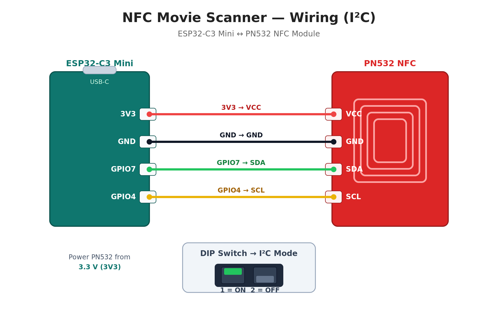

# NFC Movie Library for Plex (Home Assistant + ESP32)

An NFC-based movie library that lets kids start their favorite movies or TV shows by simply tapping a card.

This project was inspired by [u/Xafke's](https://www.reddit.com/user/Xafke/) NFC movie library. I built my own version using **ESP32**, **Home Assistant**, and **Plex** so my 2-year-old can start movies independently.

The idea is simple: tap an NFC card → Home Assistant receives the tag → an Automation calls the Plex API → playback starts on the Apple TV.

Original Reddit post: https://www.reddit.com/r/homeassistant/comments/17xdxti/how_i_built_an_nfc_movie_library_for_my_kids_ha/


## How it works

The system flow looks like this:

```
NFC Tag
  ↓
ESP32 + PN532
  ↓
Home Assistant
  ↓
Home Assistant Automation
  ↓
Plex API
  ↓
Apple TV / Plex Player
```

When a tag is scanned:

1. The **ESP32 reads the NFC tag**
2. The tag ID is sent to **Home Assistant**
3. A **Home Assistant Automation** is triggered
4. The Automation calls the **Plex API**
5. Plex starts playback on the selected player

## Hardware

All components were purchased from **AliExpress** and the total cost was about **100 SEK** (~10 USD/EUR).

Required hardware:

- **ESP32-C3 Mini**
- **PN532 NFC Reader**
- **NFC tags/cards**
- **USB-C cable**
- Enclosure / box 52 x 82 x 35 mm
- Jumper cables, and soldering supplies

I originally tried a **3D printed case**, but it was too shallow for the USB-C cable. I'm currently testing a plastic enclosure sized 52 x 82 x 35 mm. Minimum internal height required is about **25 mm**.

### Wiring (I²C)

The PN532 is connected to the ESP32-C3 Mini over **I²C**. Only four wires are needed:



| PN532 pin | ESP32-C3 Mini | Wire |
|-----------|---------------|------|
| **VCC**   | **3V3**       | red    |
| **GND**   | **GND**       | black  |
| **SDA**   | **GPIO7**     | green  |
| **SCL**   | **GPIO4**     | yellow |

Power the PN532 from **3V3**. The module has an onboard regulator and tolerates 3.3–5 V, but 3V3 is the safe choice on the C3.

**Important — set the DIP switch to I²C mode:** on the PN532 module, set **Switch 1 = ON** and **Switch 2 = OFF**. Many boards ship in UART/HSU mode by default (both switches OFF), and the reader will not respond over I²C until this is changed.

## Home Assistant Setup

This project uses:

- **ESPHome** for the ESP32
- **Plex Integration** in Home Assistant
- **Home Assistant Automations**
- **Plex API calls** (via deeplinks and REST commands)

Important note: I initially only used external services such as TV4 Play, Disney+, SVT Play and Max, but there is a lot you can't control in some of those apps — like choosing who is watching, which was a dealbreaker for me. We also had a weekend without internet access, so a local-first approach mattered. That's why **Plex** ended up being the best choice.

### Stop playback before starting a new video

Sometimes the Plex app on Apple TV would freeze when starting playback. To fix this, the Automation first sends a **stop command** to the media player before starting a new item.

```yaml
- action: media_player.media_stop
  target:
    entity_id: media_player.YOUR_TV
```

### Force playback from the beginning

Plex normally resumes playback where you left off. To avoid this, the Automation appends `&resume=0` to the deeplink so playback always starts from the beginning. For single items (movies/episodes) it also marks the item as watched first via a REST command, which clears the resume position.

```yaml
- action: rest_command.plex_mark_watched
  data:
    rating_key: "{{ nfc_mapping[current_tag_id].plex_id }}"
    token: "{{ plex_token }}"
```

### Disable intro and credits detection (recommended for kids' content)

Short kids' shows can lose a lot of content when auto-skip is enabled. Disable this in Plex:

1. Edit the library
2. Scroll near the bottom
3. Disable:
   - `Enable intro detection`
   - `Enable credits detection`

## The shuffle journey: why Smart Playlists won

This was the trickiest part of the whole project, and it went through several dead ends before I found something that actually worked. I'm writing it all down here because I couldn't find a clear answer anywhere, and hopefully it saves someone else a few evenings.

**What I wanted:** tap a card → a *random* episode of that show starts from the beginning → when it ends, *another random* episode plays automatically. Endless shuffled playback for a toddler.

**Attempt 1 — Collection, play the first item.** My original automation fetched a Plex collection's children over REST and always grabbed item `[0]`. That plays exactly one episode, always the same one, with no queue behind it. No shuffle, no auto-advance. Dead end.

**Attempt 2 — Server-built PlayQueue with `shuffle=1`.** Building a PlayQueue on the server via `POST /playQueues?shuffle=1&continuous=1` genuinely works: the server returns a shuffled queue and a random start episode (I confirmed it returns a different `playQueueSelectedMetadataItemID` every time). Playing it via a `plex://play/?metadataKey=/playQueues/<id>` deeplink started a random episode — great! But when the episode ended, the Apple TV client ignored the shuffled queue and auto-advanced *sequentially* through the series (episode 12 → 13 → 14). The client's own "play next episode" logic overrides the queue.

**Attempt 3 — Turn off "Auto-Play Next Episode" on the Apple TV.** With that setting off, the player simply stopped at the end of the episode instead of shuffling. So the queue still wasn't driving playback.

**Attempt 4 — Control the Plex client directly from HA.** Casting a shuffled playlist to `media_player.plex_atv_vardagsrum` looked cleanest on paper, but the Apple TV Plex client only exposes `PLAY_MEDIA` + `BROWSE_MEDIA` (`supported_features: 131584`) — no `SHUFFLE_SET`, no next-track control. So `{"shuffle": 1}` was silently ignored, and it reintroduced the cold-start delay I was trying to avoid (the app has to be awake and reporting before HA can control it).

**Attempt 5 — Regular playlist deeplink.** A normal (static) playlist plays in its saved order, and `shuffle=1` on the deeplink is ignored by the client. Same fixed order every time.

**The winner — Smart Playlist with random sort.** A Plex **Smart Playlist** with sort set to random (`sort=random:desc`) is re-evaluated *server-side* every time it's opened. Opening it via a plain deeplink gives a genuinely new random order on every scan, and — crucially — the Apple TV client treats it as a *playlist queue* and auto-advances within that shuffled order instead of running its sequential episode logic. Adding `&resume=0` makes each episode start from the beginning.

The final deeplink is beautifully simple:

```
plex://play/?metadataKey=%2Fplaylists%2F<SMART_PLAYLIST_ID>&server=<SERVER_ID>&resume=0
```

No REST calls, no XML parsing, no server-side PlayQueue, no cold start. Just one `play_media` call per scan.

### How to create the Smart Playlists

Smart Playlists have to be created manually in the Plex web UI (Kometa can build collections and regular playlists, but its `smart_filter` explicitly does **not** work with playlists). For each show:

1. In Plex Web, open the library and build an Advanced Filter that matches the show (e.g. `Show Title == Bluey`, item type `Episode`).
2. Set the sort to **random**.
3. Save it as a Smart Playlist.
4. Grab the playlist ID from the URL (`/playlists/<ID>`) and put it in the automation's `nfc_mapping`.

Because Smart Playlists are dynamic, new episodes are picked up automatically — no maintenance needed.

## Card mapping

Each NFC card is mapped in the automation's `nfc_mapping` variable. A card can point to one of three things:

- **`plex_id`** — a single movie or episode. Played directly, marked watched first so it starts from the beginning.
- **`playlist_id`** — a Smart Playlist. Random episode, shuffled auto-advance, starts from the beginning.
- **`deeplinkurl`** — an external app deeplink (TV4 Play, Disney+, etc.) for content not in Plex.

Example:

```yaml
nfc_mapping:
  04-XX-XX-XX-XX-XX-XX:
    name: Bluey
    playlist_id: 00000        # Smart Playlist -> shuffled episodes
  04-YY-YY-YY-YY-YY-YY:
    name: Frozen
    plex_id: 00000            # Single movie
  B6-ZZ-ZZ-ZZ:
    name: Morning News
    deeplinkurl: tv4play://details/xxxxxxxx?autoplay=true
```

## Project goals

The goal of this project was to:

- Make media accessible for a **2-year-old**
- Remove the need to navigate Plex menus
- Create a **physical media library**
- Keep it **simple and cheap** to build
- Be **local-first**, so it works even without internet

## Credits

Huge credit to [u/Xafke](https://www.reddit.com/user/Xafke/) for the original idea and inspiration. Here's the write-up: https://simplyexplained.com/blog/how-i-built-an-nfc-movie-library-for-my-kids/

If you're interested in building something similar, feel free to use the configs in this repo.
